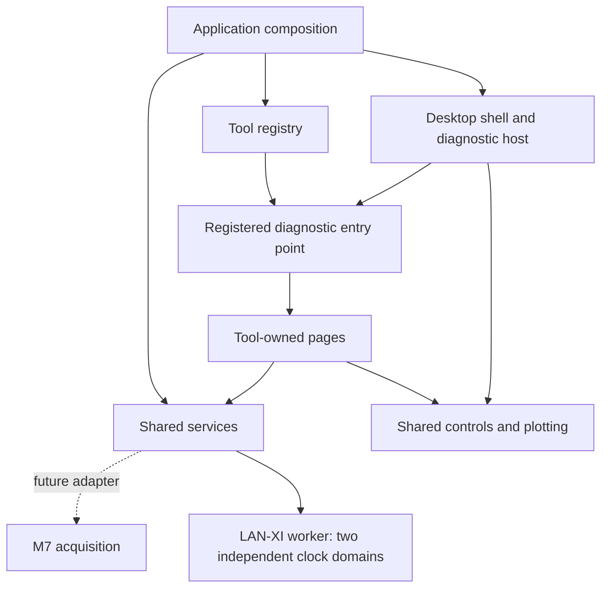

# Application architecture

The product is a diagnostic desktop with build-time tool modules. A tool owns
its screens and workflows; the desktop owns launching and navigation. This
separation allows another diagnostic to be added without editing application
startup or adding diagnostic-specific conditions to the shell.

The implementation currently builds one executable and one QML module. The
directories below express source ownership and dependency direction; they are
not separate shared libraries or independently deployable plugins.

## Ownership

| Directory | Responsibility | Does not own |
| --- | --- | --- |
| `src/app` | Process entry, application composition, boot readiness and shutdown | Individual diagnostic pages |
| `src/shell` | Desktop, launcher, dock, tool host, navigation and boot presentation | Diagnostic calculations or transport decoding |
| `src/shared` | Reusable controls, icons and native plot rendering | Tool routing and acquisition state |
| `src/services/diagnostics` | Shared session ownership, current diagnostic analysis, profiles and CSV recording | M7 transport implementation |
| `src/services/acquisition/lanxi` | LAN-XI HTTP/TCP control, native decoder/analysis and archive I/O on a worker thread | QML pages or M7 transport |
| `src/services/desktop` | Notes, results access, preferences and storage information | Diagnostic tool screens |
| `src/tools/diagnostics/<tool>` | Tool entry point, pages, settings UI and workflow | Desktop chrome and direct board transport |
| `src/tools/utilities/<tool>` | Supporting-tool UI and local behavior | Diagnostic acquisition ownership |
| `cmake` | Source collection and completeness checks | Generated sources or machine-specific SDK paths |
| `scripts`, `tests`, `docs` | Development validation, packaging and integration contracts | Application runtime dependencies |



Application composition creates the registry and diagnostic session once and
injects them into the shell. `ToolRegistry.qml` contains stable IDs, launcher
metadata and diagnostic entry paths. `DiagnosticWorkspace.qml` renders the
compact header, navigation and feedback. `DiagnosticToolHost.qml` receives
descriptors and creates the selected entry component.

The shell has no Live Electrodogram/Acoustic Analytics routing branch. Acoustic
Analytics owns its DSP and microphone tabs in `AcousticAnalytics.qml`.
The launcher filters diagnostics, while the dock also includes utilities.
Utilities use a separate host to coordinate their different document and
preference lifecycles.

## Tool contract and lifetime

Each diagnostic entry point is a visual QML `Item` exposing:

```qml
required property var session
property real uiScale: 1
```

The host supplies the existing diagnostic session during creation and binds the
scale to the workspace. The host sets the entry item's size. A tool positions
its content within that size and does not assume a full 1920 x 1080 viewport.
Main navigation, fullscreen expansion and the status line remain shell concerns.

A tool is created on its first selection. Its loader stays alive when the user
returns to the desktop or opens another diagnostic, preserving settings, tab
selection and view state. Resizing or F10 changes geometry only. A load failure
offers Retry and Show details, and is also retried when the tool is reopened.
The error probe reads the component definition's `errorString()` without
creating another tool instance. Creation failures without component errors
direct the user to Application Output. Runtime mutation of the registry is
not supported in this phase: the catalog is fixed at build time.

The shared session owns start/stop acknowledgements and prevents changing the
active acquisition mode while busy. A tool must not start hardware from
`Component.onCompleted`, stop hardware merely because it is hidden, or create
a second acquisition owner. Entry visibility is presentation state, not a
measurement command. Use explicit user actions and the session API.

The current service recognizes four measurement modes, including native
`lanxi-measurement`. Its capability report is combined with the M7 report without
replacing it. The LAN-XI worker keeps the shared ownership lock through stop
recovery; its inspection, replay and export also prevent starting another tool.
The worker publishes bounded display snapshots at up to 10 Hz; TCP processing,
FFT and disk I/O never run in QML. See [LANXI_INTERFACE.md](LANXI_INTERFACE.md).
Adding a new UI
entry does not implement another acquisition protocol. A new measurement mode
needs service validation, capability handling, data processing and tests, plus
the later backend adapter work. Keep the mode unsupported until that path exists.
See [ACQUISITION_INTERFACE.md](ACQUISITION_INTERFACE.md).

## Build boundaries

The repository-root `CMakeLists.txt` defines the executable, Qt module and
deployment. `cmake/ProjectSources.cmake` includes each layer's `Sources.cmake`;
`src/tools/Sources.cmake` explicitly includes each built-in tool's manifest.
The files listed there are passed to `qt_add_qml_module` using their repository
paths. This keeps resource URLs aligned with relative imports in the source.

Each tool manifest may append to `FRDM_QML_FILES`, `FRDM_NATIVE_SOURCES` and
`FRDM_RESOURCE_FILES`. Native include directories are collected from the source
list for Qt's generated type registrar. The project does not glob tool code
into the application: adding a folder alone does not enable it.

All QML types currently share `FRDM_IMX95_QT_DSW`. Use distinctive filenames for
new tool components and native QML types; duplicate exported type names are not
separate just because their folders differ. `VerifySources.cmake` rejects
duplicate QML type names and missing sources before Qt runs.

No platform transport belongs in a QML page. The services boundary is the place
to connect an approved Windows test adapter or the eventual Linux/M7 adapter.
Yocto image recipes, startup configuration and M7 transport code remain future
work until the BSP and interfaces are defined; see [BOOT_HANDOFF.md](BOOT_HANDOFF.md).

## Development workflow

1. Make a feature change in its owning tool or service. Put a component in
   `shared` only when it has a reusable responsibility.
2. List every new runtime file in the appropriate source manifest. Register a
   new diagnostic entry using [ADDING_DIAGNOSTIC_TOOL.md](ADDING_DIAGNOSTIC_TOOL.md).
3. Run the applicable calculation/routing checks and source validation. Use
   `python scripts/package_source.py` to transfer the complete tree.
4. In the approved Qt environment, configure a fresh build after this migration,
   compile, run `all_qmllint`, and exercise the affected workflows.
5. Validate the display, input, acquisition rates and startup on the actual
   FRDM i.MX95 before deployment.

The source refactor does not establish binary/plugin compatibility, add a
transport or prove runtime rendering. The registry/lifecycle tests exercise
JavaScript decisions without Qt; the UI lifecycle still needs the interactive
checks in [DESKTOP_SHELL.md](DESKTOP_SHELL.md#validation).

Qt references: [Loader creation and sizing](https://doc.qt.io/qt-6/qml-qtquick-loader.html)
and [QML module/resource generation](https://doc.qt.io/qt-6/qt-add-qml-module.html).
