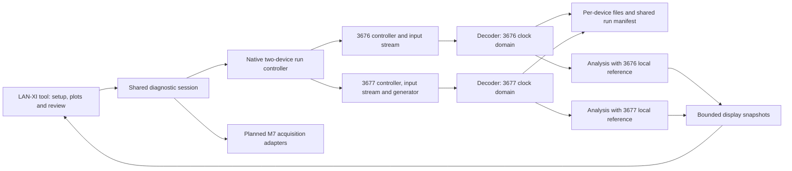
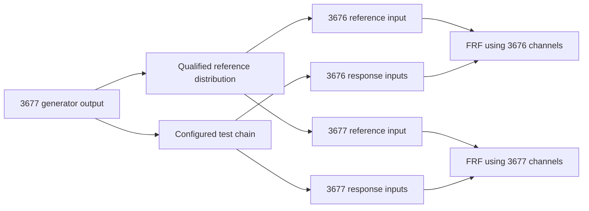

# LAN-XI Measurement Studio — development plan

Prepared 18 October 2026. For current delivered/remaining features see
[LANXI_FEATURES.md](LANXI_FEATURES.md). The request now includes broader feature
development before hardware validation; the exact BK Connect version/options
are still unspecified. The stages below describe the original first-release plan.

Original implementation status: the five-page tool and
native paired HTTP/TCP backend are implemented, including profiles, calibration,
generator control, analysis, recording, replay and export. The decoder/analysis
core and shared-session checks have run without Qt. The Qt backend integration
harness and hardware acceptance remain pending in the approved environment.
No physical LAN-XI module has been connected from this workspace.

The tool lives in `src/tools/diagnostics/lanxi/`, with its native acquisition
service in `src/services/acquisition/lanxi/`. See [LANXI_INTERFACE.md](LANXI_INTERFACE.md)
for the implemented API, operating instructions, storage and test commands.
The design and release milestones below remain acceptance criteria; implementing
source code does not establish firmware compatibility or hardware qualification.

Build a third diagnostic tool in Suno that operates the existing LAN-XI hardware.
Use a measurement workflow comparable to BK Connect: configure, calibrate,
measure, record and review. The working name is **LAN-XI Measurement Studio**,
with registry ID `lanxi-measurement`. Implement an original Suno interface and
measurement engine using the documented LAN-XI protocol.

Confirmed scope: **Type 3676 and Type 3677 must operate together in the first
release**, with **acoustic measurement, generator control and frequency response**.
The device under test changes between microphone and amplifier applications,
so provide reusable test profiles instead of a fixed wiring arrangement.
Firmware, full model suffixes, front panels, quantities and each test chain's
electrical/acoustic details remain to be recorded. One application session will
coordinate both devices; concurrent operation must be proven with the actual pair.

| Hardware | Documented capability | First-release role |
| --- | --- | --- |
| Type 3676 | Four inputs; no generator output | Input/reference channels in the shared test session |
| Type 3677 | Four inputs plus one generator output | Input/reference channels plus the session's stimulus source |

Both are LAN-XI Light units with a specified 25.6 kHz measurement span. Verify
the actual front panel before exposing conditioning options: Type 3676 uses
UA-2100-040; Type 3677 can use UA-3100-041 or the optional UA-3102-041 panel for
200 V microphones. [HBK model data](https://www.bksv.com/doc/bp2586.pdf).

**Hardware constraint:** LAN-XI Light Types 3676/3677 do not support PTP or the
sample-synchronous multi-module arrangement of other LAN-XI models. Plan
concurrent, independently clocked acquisition under one session, preserving both
time bases. Keep every FRF reference/response pair within one module. One Start
button or a common electrical reference does not create synchronized sampling.
[HBK Open API specifications](https://www.bksv.com/-/media/literature/Product-Data/bp2630.ashx).

The engineering proposal is to feed an appropriate reference to an input on each
module and calculate two sets of locally referenced responses. Qualify the
reference distribution and comparison accuracy on hardware. Truly time-aligned
eight-channel data, cross-module coherence, beamforming or transient phase
analysis would require a separate timing solution or different hardware.

## 1. Product scope

| Release | User-visible capabilities | Dependencies |
| --- | --- | --- |
| First hardware milestone | Acquire from both modules concurrently, with 3677 providing a limited sine and a measured reference on each device; save/replay both streams and stop output cleanly | Installed firmware, network capacity and qualified reference/response connections |
| First usable release | One session controlling both modules; microphone/acoustic and amplifier profiles; channel setup/calibration, waveform/FFT/levels, recording/replay and exports; 3677 sine, stepped-sine and band-limited-noise excitation with local-reference FRF magnitude/phase and coherence on each device | Verified two-device controller, generator API, independent-clock records and validated profile-specific test chains |
| Follow-on analysis | A/C weighting and specified time weighting, octave/third-octave analysis, spectrogram, result comparison, test templates and report output | Agreed algorithms, reference cases and measurement tolerances |
| Follow-on hardware workflows | Additional devices, accelerometer workflows, extra stimulus types and automation | New capacity and workflow tests; synchronized expansion requires a suitable timing/hardware solution |

Generator control and frequency response are required first-release work on
3677. Vibration-specific workflows, modal analysis, order tracking and sound-power
analysis need their own requirements. Native `.bkc` compatibility is also a
separate requirement; the first release uses documented stream data and our
versioned project metadata.

### Reusable test profiles

| Profile/workflow | Reference and response | Results and required setup |
| --- | --- | --- |
| Acoustic measurement | Calibrated measurement microphones; optional measured electrical excitation reference on each module | SPL/FFT/recording; pressure-to-drive response in Pa/V describes the whole acoustic chain, including source and environment |
| Microphone under test | Known acoustic pressure from a calibrated reference microphone/fixture, and the test microphone's electrical output; each comparison pair is acquired locally | Sensitivity in V/Pa and frequency response; retain reference calibration, microphone powering, preamplifier gain and acoustic arrangement |
| Amplifier under test | Actual amplifier input voltage as reference, output voltage through a suitable measurement interface as response, both captured locally | Gain in V/V or dB, phase and coherence; record attenuation/probe scaling, load and allowed input/output levels |

The user selects **Microphone/Acoustic** or **Amplifier**, then chooses the
measurement workflow and channel roles. Save each test setup with device serials,
local reference mappings, units, sensitivity/calibration, coupling/conditioning,
stimulus limits, frequency plan and analysis settings. Validate it against the
connected hardware when loaded. Switching profiles requires a stopped session
and a new configuration snapshot; it must not silently reuse incompatible units,
conditioning or an earlier result.

For microphone characterization, a generator voltage and a loudspeaker alone
do not establish acoustic pressure at the microphone. Use a qualified acoustic
reference arrangement. Distribute a reference sensor's conditioned output only
through an appropriate interface; do not assume two sensor-powering inputs can
be directly paralleled. Amplifier profiles must define a suitable attenuator,
differential/isolation interface and load for the actual amplifier output.
The tool stores these configurations; it does not assume one universal circuit.

## 2. Hardware and build information to establish first

Record the following in a compatibility sheet during milestone 0:

| Information | Decision it enables |
| --- | --- |
| Full suffix, serial, front panel, firmware and quantity for the confirmed Types 3676/3677 | Exact capabilities and installed API behavior |
| Microphones, preamplifiers, accelerometers or voltage inputs; sensor sensitivities and available calibrator | Conditioning, units and calibration workflow |
| Active channels, required bandwidth/sample rates and maximum session duration | Network, CPU, memory and disk budgets |
| Per-profile device under test, reference distribution, amplifier/speaker or load, measurement interface and level/frequency range | Stimulus limits, conditioning, channel roles and the meaning of the measured response |
| Module IP/network topology and power supply | First wired connection; the FRDM Ethernet port is not assumed to power the module |
| Existing licensed reference software or other reference instrument | Sequential comparison measurements and acceptance tolerances |
| Intended NXP BSP, Qt version, graphics backend, storage and network interface | Yocto compatibility and early ARM64 build |

Use the module's documented capabilities instead of hard-coded rates, channel
counts or input ranges. TEDS data must be checked against the attached sensor
and front panel before applying conditioning. A firmware update is a separate
maintenance action; it is not part of automatic connection.

## 3. Connection and processing architecture

Proposed LAN-XI path: **LAN-XI → Ethernet → Linux on the Cortex-A55 → Suno**.
The LAN-XI hardware owns sampling; the application owns control, processing,
storage and presentation. This path can also run in the approved Windows Qt
environment for initial hardware testing. The other tools keep their planned
M7 UART and FlexIO integration paths.

HBK documents HTTP/JSON control and a separate binary measurement stream. Its
single-module tutorial obtains a TCP streaming endpoint from the module. These
provide the basis for the proposed portable backend.
[API overview](https://github.com/hbkworld/open-api-tutorials),
[single-module acquisition](https://github.com/hbkworld/open-api-tutorials/blob/master/tutorials/streaming_single_module.md).



Use C++ for network I/O, protocol decoding, sample buffers, analysis and recording.
Expose channel models, status and bounded plot/metric updates to QML. Qt Network
is the proposed HTTP/TCP layer; declare `Network` explicitly in CMake and link
`Qt6::Network`. The current target directly requests only `Quick`.
[Qt Network build integration](https://doc.qt.io/qt-6/qtnetwork-index.html).

Network, processing and disk work must not block the GUI thread. Start with a
display update target of 20–30 Hz, independent of sample rate. Use bounded queues
and min/max waveform reduction so peaks survive display decimation. Raw recording
must receive the full accepted stream. Queue exhaustion or device data loss must
produce visible quality errors and an explicit recording outcome.

Use device timing and sample counts for signal alignment. Network arrival time
is a transport diagnostic, not the measurement clock. Keep full timestamps and
sample counters in native integer types; expose relative plot coordinates to QML.

Each device needs its own control connection, stream parser, bounded buffers and
timing metadata, identified by serial/device ID rather than model name alone.
The group start waits for both devices to report acquisition ready before
enabling stimulus. This is a readiness barrier, not a simultaneous sample trigger.
If either device fails during setup, stop/close the already-started peer and keep
output disabled. If either fails during a test, the default is output off and
group stop, with a recorded partial-run reason. No silent downgrade to one module.
Report the group's terminal state only after each device's state and file outcome
are known; keep unresolved hardware state visible and retain ownership.

## 4. Fit into the current project

The registry and lazy tool host already support another built-in diagnostic.
The current session, however, explicitly accepts only `live-electrodogram`,
`dsp-calibration` and `automatic-mic`. It uses JavaScript arrays and CSV writing
for existing workflows. Adding a registry entry alone would not support LAN-XI.

Proposed ownership:

```text
src/tools/diagnostics/lanxi/
  Sources.cmake
  qml/
    LanXiStudio.qml
    LanXiProfiles.qml
    LanXiSetup.qml
    LanXiCalibration.qml
    LanXiStimulus.qml
    LanXiMeasure.qml
    LanXiResponse.qml
    LanXiReview.qml
  native/                  Tool-specific analysis and plot models

src/services/acquisition/lanxi/
  Sources.cmake
  LanXiRunController.*     One session coordinating both devices and rollback
  LanXiController.*        Per-device configuration, state and acknowledgements
  LanXiDecoder.*           Framing, sample interpretation and quality events
  LanXiGenerator.*         Stimulus configuration, output state and stop handling
  LanXiRecorder.*          Per-device stream segments and shared run metadata

tests/lanxi/               Native protocol, calculation and lifecycle tests
docs/LANXI_INTERFACE.md    Accepted commands, states and data contract
```

Use short, distinctive component names to reduce generated MinGW paths and
avoid collisions in the shared QML module. Keep the existing short-build-folder
check. These paths are proposed ownership boundaries, not files created by this plan.

Implementation changes must include:

1. Add the tool manifest to `src/tools/Sources.cmake`, and the backend manifest
   through `src/services/Sources.cmake`. Register the tool once its first
   functional workflow is available; unfinished hardware actions stay disabled.
2. Preserve the entry contract `session` and `uiScale`. Compose one native run
   controller owning a controller for each device. Expose its model through
   `session.lanxi`; QML pages do not open sockets.
3. Extend session validation and lifecycle for `lanxi-measurement`. Keep the
   shared session authoritative for the active run and ticket. Native callbacks
   retain the run ticket, device ID and connection generation, and are marshalled
   onto the GUI thread so late replies from either device cannot affect a new run.
4. Aggregate capability reports by backend so a LAN-XI update cannot erase M7
   availability. Keep one active diagnostic run at a time, with both LAN-XI
   devices participating inside that run. Start requires the selected profile's
   capabilities on both devices; two modules do not create two session owners.
5. Retain start/stop acknowledgements and add recovery handling for an unknown
   device state. A timeout must not falsely release ownership. Navigation,
   application close and retry must respect that state.
6. Extend result browsing to recognize LAN-XI session folders and metadata.
   The current browser lists only top-level CSV/text files and is not a waveform
   archive reader. Route a session into this tool's review page.
7. Keep generator state inside the same acquisition owner. Capability-gate it
   to 3677 and coordinate output enable/stop with recording and measurement.
   A standalone tone test also acquires the session lock. Opening a page,
   reconnecting or loading a saved setup must never enable output.

Review reusable plot rendering in `src/shared/plotting`; add native batched models
where needed. Do not move full-rate acquisition into `Analysis.js` or add tool-ID
branches to the desktop shell.

## 5. Measurement workspace at 1920 × 1080

Use the existing compact tool header and **Exit full screen** action. The
workspace opens with hardware setup and progresses through **Setup → Calibrate
→ Stimulus → Measure → Review** for the selected test profile. Acquisition-only
workflows skip Stimulus.
Each step retains its settings when the user changes pages.

In Measure, use the available width approximately as follows: a 250-pixel channel
pane, a 1,318-pixel central plotting area and a collapsible 280-pixel inspector,
inside the existing margins and two 16-pixel gaps. These are reference dimensions;
layout responds to the actual tool viewport and Windows scaling.

| Area | Content |
| --- | --- |
| Compact command row | Readiness of both modules, test profile, run name, group Start/Stop/Record and elapsed time; visible 3677 output state and Output off |
| Left pane | Both modules with separate channel groups, local reference assignments, sensor/unit, quality and independent-clock indication |
| Central area | Large waveform/spectrum panes; Frequency Response view with magnitude, phase and coherence; maximize a pane; cursors, zoom and reference/response selection |
| Right inspector | Settings for the selected channel or analysis; collapsible to enlarge graphs |
| Bottom status | Per-device recording/quality state, free storage, overload/gap indicators and actionable errors |

Setup uses the main area for a channel table rather than squeezing all settings
beside empty plots. Calibration presents reference level/frequency, measured
stability, sensitivity and a saved verification result. Review opens recorded
sessions with their configuration and quality history. Display pause freezes
the preview while acquisition/recording continue; it is distinct from Stop.

The Stimulus page selects waveform, frequency or sweep range/step, dwell and
settling time, level, ramping and duration. It displays the measured reference
level alongside the requested output level. Keep output state and Output off
visible from every page while generating. The 3676 exposes input controls; the
run's generator controls always address the selected 3677 output.

Group waveforms by device with separately identified time axes. A shared run
view may show overall progress, but it must not suggest sample-aligned transients
across modules. FRF selectors require a local reference; show independently
calculated curves with their device, reference and units attached.

## 6. Data accuracy and recording requirements

Parse the documented message framing incrementally: one TCP read is not one
message. Validate sizes, versions, signal identifiers and byte order before
allocating or decoding. Retain interpretation and data-quality messages.

HBK's stream interpretation includes sample type, scaling, period and engineering
unit. Use those descriptors to decode samples and preserve validity changes,
overloads and gaps. Sensitivity may already be included in the device's scaling;
do not apply microphone sensitivity a second time. If sensitivity or units are
unknown, report the known electrical quantity and require calibration before
reporting acoustic pressure. Channels may end with different sample counts;
review must preserve that distinction.
[HBK stream interpretation](https://github.com/hbkworld/open-api-tutorials/blob/master/tutorials/streaming_interpretation.md).

Define the analysis contract before coding: FFT length and window, overlap,
averaging, frequency resolution, amplitude versus power/PSD, dB reference,
measurement bandwidth, DC handling and valid-data policy. For calibrated pressure,
SPL uses RMS pressure relative to 20 µPa. Initially label the result explicitly
as unweighted over the configured bandwidth. Do not imply sound-level-meter
certification from implementing a formula or displaying a weighting selector.

Save one versioned run manifest with a separate original-stream recording for
each device. Include device identities/firmware, clock domains, actual sample
rates/counts, per-channel start/end times, accepted configuration, profile,
reference mappings, calibration, quality events and individual completion states.
The common run ID groups the evidence; it does not assert aligned timestamps.
Use native writers with bounded buffering and free-space checks. Mark incomplete
runs after disconnect or disk failure. Keep atomic metadata updates and a
restart-recovery procedure; a file's existence does not mean a run completed.

Export processed tables to CSV with device/channel identifiers and waveforms to
per-device WAV files with documented scaling/timing metadata. Do not export an
apparently synchronized eight-channel WAV. Segment exports before container or
filesystem limits and test precision and mapping by round trip. Replaying both
streams should reproduce each device's analysis without attached hardware.

### First-release stimulus and frequency response

Use the 3677 generator and record the appropriate reference on both modules.
The proposed logical arrangement for an electrical-reference test is:



Choose the actual tap, conditioning, distribution, attenuation and grounding
from the selected profile. Measuring before an amplifier includes that amplifier
in the response. Microphone sensitivity testing replaces the electrical reference
with a qualified acoustic reference chain as described above.

One reference input on each module leaves **up to six response inputs plus two
reference inputs** across the pair. Capture-only workflows may use all eight
as measurement inputs when no local FRF reference is needed. A common reference
does not lock the ADC clocks: calculate each FRF on its own device's time base.
Cross-module raw-channel phase/coherence selection is unavailable in version one.
Comparing independently estimated FRF curves needs reference-path gain/phase
validation, stable test conditions and compatible frequency grids. Software
resampling or delay estimation is not a promised replacement for clock locking.

Proposed version-one stimulus modes are fixed sine for verification, stepped
sine for a response sweep, and band-limited noise for averaged broadband FRF.
Verify each path against the installed firmware, using supported on-module
generation or native waveform preparation/streaming as appropriate. Save actual
accepted settings, voltage convention (peak/RMS), peak limits, sweep points,
settling/dwell periods, output state and any underruns with the recording.
Requested generator voltage is not a measurement of acoustic SPL.

For stepped sine, evaluate the settled reference and response at each tone;
record magnitude, phase and point validity. For noise, compute an H1 estimate
from averaged auto/cross spectra, plus coherence using the same averaging.
Use more than one independent average for meaningful coherence. Identify weak
reference bins, clipping, gaps and unsettled points instead of displaying a
plausible response there. Validate estimator convention, phase sign, windowing,
leakage and delay treatment. Keep propagation delay unless explicitly corrected
and record any correction. [HBK frequency-analysis reference](https://www.bksv.com/doc/bn1445.pdf).

A stepped-sine controller advances only after both devices have collected the
required settled data for that point, verified from their local references.
Host command timestamps alone do not define an analysis window. Save per-device
validity when one stream has a gap or finishes a point late.

Label the transfer units: a pressure response divided by an electrical reference
is Pa/V, not SPL. A logarithmic transfer plot needs an explicit reference such as
1 Pa/V; a two-pressure-channel transfer can be dimensionless. SPL remains a
separate calibrated pressure measurement.

Output starts disabled. Enforce limits based on both hardware and the connected
test item, with explicit user enable and suitable ramps. Normal completion or
Stop turns output off, confirms the output state, captures the required decay,
then stops both acquisitions and finalizes both recordings. On a fault in either
device, prioritize output shutdown and report an unknown output state if its
acknowledgement is lost.
Verify the module's actual behavior on host crash, network loss and output-stream
underrun; do not assume that losing the socket mutes it. Define and validate the
required independent output-off mechanism for the test chain before excitation.

## 7. Delivery milestones and acceptance

| Milestone | Work | Evidence required before proceeding |
| --- | --- | --- |
| 0 — Compatibility | Inventory both devices; define microphone/acoustic and amplifier profile requirements, reference distribution, limits, rates/duration, tolerances and license route; check BSP/Qt gap | Two-device capability matrix, clock-domain design and output-stop strategy |
| 1 — Paired hardware proof | Stream both modules concurrently; use 3677 stimulus with a measured reference on each; record/replay and stop the group | Expected local loopback gain/phase on each device, independent timestamps preserved, output off and both devices released |
| 2 — Native backend | Group controller, per-device decoders/writers, generator and stepped-sine coordination, quality and rollback | Partial-start, peer-disconnect, stale-callback and storage-failure tests pass; early ARM64 paired-input/output check when BSP is available |
| 3 — Tool workflow | Register third tool; profile selection, two device groups, channel/calibration setup, Stimulus, Measure, FRF and Review | Every QML page loads; group readiness/output and independent timing are visible; profile switching, reopen/F10 and existing tools tested |
| 4 — Analysis and evidence | Waveform/FFT/levels, per-device sine/noise FRFs, calibrated microphone workflow, amplifier gain/phase, paired replay and exports | Known transfer tests per device, validated reference distribution and repeatable results for both test profiles |
| 5 — Yocto release | Cross-build/package; network, storage, startup, 1920 × 1080 UI and measured performance | Sustained concurrent capture at the declared paired configuration; bounded memory, output-off and group recovery proven on FRDM i.MX95 |
| 6 — Expansion | More devices, extra stimuli, advanced acoustics and vibration; sample-synchronous workflows only with a separate timing/hardware solution | New capability-specific acceptance tests |

Milestone 0 unlocks the numerical acceptance limits and a credible calendar
estimate. Milestone 1 should precede detailed UI polishing. UI work can use
recorded fixtures while backend work continues, clearly identifying replay mode.
Begin Linux compatibility work early; the board release depends on the BSP and
Qt version, which remain unspecified. The current application requires Qt 6.10+.

## 8. Verification strategy

| Layer | Required checks |
| --- | --- |
| Protocol | Arbitrary TCP splits/coalescing, signed sample extremes, descriptor ordering, unknown signal IDs, unsupported version, malformed/oversized messages, truncated streams and quality-state changes |
| Analysis | Known tones/noise, DC/Nyquist, window normalization, RMS/peak, amplitude/PSD, scaling once, invalid samples; unity/known-gain and known-delay FRF, noise/coherence, weak-reference rejection, settling and reproducible phase |
| Lifecycle | One module busy/missing; second-device start failure and rollback; stale device-generation callbacks; stop while starting; either cable removed; generator faults; no automatic excitation on reconnect; group close and recovery |
| Recording | Per-device counts/clock domains, drift/start-offset simulation, asymmetric stream loss, disk full, slow storage, partial runs, crash recovery, segment boundaries, separate exports and paired replay |
| UI | Qt component-load tests for all tools/lazy pages; `all_qmllint`; 1920 × 1080/scaling; profile switching/conditioning validation; cross-device FRF-pair rejection; no acquisition or output from opening a page |
| Hardware | Concurrent operation of both units, reference distribution, local gain/phase on each, 3677 output/stop behavior, microphone reference and amplifier interfaces, throughput and long-duration drift |

Use BK Connect as a comparison instrument only where already licensed and
available. Run sequential comparisons: HBK's tutorial explains that opening the
module recorder claims control against other applications. Avoid two controllers
competing for the same module. A generator run follows the output-off sequence
above. Stop acquisition before closing its stream and finalize evidence before
releasing the session.
[HBK acquisition lifecycle](https://github.com/hbkworld/open-api-tutorials/blob/master/tutorials/streaming_single_module.md).

Proposed release target: a one-hour concurrent capture on both modules at the
agreed channel/rate configuration, stable memory, no unexplained gaps and
per-device recording counts reconciled. Measure start offsets and relative clock
drift without relabelling them as synchronization. Include a generator run of
an appropriate duration for each test profile. Test longer acquisition durations
when required. UI 20–30 Hz is a profiling target pending board measurements.

The first release is complete only when the paired workflow and both profile
families pass. Separate single-module checks are development steps, not a
substitute for the requested two-module result. Reference-path comparison and
cross-device sample synchronization are separate acceptance questions.

## 9. Dependencies and licensing

HBK's Open API data sheet specifies access from firmware 2.10.0.344, with input
streaming BZ-5951-L-N01, output streaming BZ-5952-L-N01 and recorder BZ-7848-A
shown as permanent licenses on the module. Verify firmware and the Licences page
on the installed units, including 3677 output access. Protocol access does not
establish redistribution rights for BK Connect, sample code or other libraries.
[HBK API access specification](https://www.bksv.com/-/media/literature/Product-Data/bp2630.ashx).

Plan an original protocol implementation and Suno UI. Any reused example/parser
code or FFT library needs its actual license and attribution recorded before
inclusion. Select the FFT dependency in milestone 0; avoid making the analysis
architecture depend on an unreviewed package. No BK Connect binaries, logos,
artwork or proprietary algorithms are included in this plan.

Qt Network has commercial and open-source licensing options; its inclusion and
the final Yocto image must follow the company's approved Qt distribution route.
A Visual Studio license does not determine those obligations. Keep a dependency
inventory and required notices for the actual versions shipped.
[Qt Network licensing](https://doc.qt.io/qt-6/qtnetwork-index.html#licenses-and-attributions).

Source work and non-Qt validation can continue in this workspace. Qt compilation,
QML runtime checks and hardware tests take place in the approved environment.
No new SDK, external library, firmware or application is installed by this plan.

## 10. First implementation deliverable

After recording firmware and qualified test connections, deliver: select a
profile → connect/configure both devices → start both input streams → verify
readiness → enable a limited 3677 sine → record and calculate a local loopback
response on each → turn output off → stop both → reopen the combined run with
its separate recordings. Include partial-start/peer-failure tests and approved-kit
Qt load/build checks. Expand that paired path into the microphone/acoustic and
amplifier workflows, sweeps and broadband analysis.
